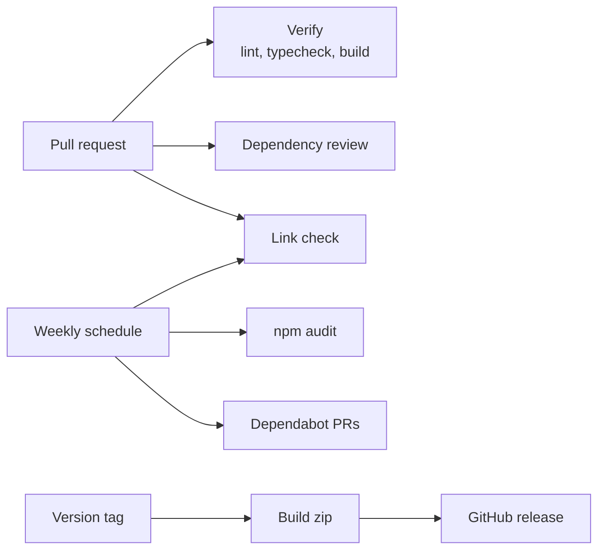

## Problem

My testing process for both of these repos used to be pushing to main and refreshing the live site. Most of my code comes from AI tools now, and there's more of it than I can review by hand. I wanted every change checked automatically before it went live.

There were two repos to cover. This blog is an Astro site deployed on Cloudflare. [ya-portal-blocks](https://github.com/johnmlilly/ya-portal-blocks) is a WordPress block plugin I built for the [Youth Apostles](https://www.youthapostles.org/) member portal.

## Pipeline

## Workflows

| Workflow | Repo | Runs on | What it does |
|---|---|---|---|
| Verify | both | PRs, pushes to main | Blog: `astro check` and `astro build`. Plugin: JS and CSS linting, block build, and `php -l` on every PHP file |
| Dependencies | both | PRs, weekly | Blocks PRs that add a high or critical vulnerability, then audits runtime dependencies every Monday |
| Links | blog | content PRs, weekly | Lychee checks every external link in posts and project pages |
| Release | plugin | `v*` tags | Builds the plugin zip and attaches it to a GitHub release with generated notes |
| Dependabot | both | weekly | Grouped PRs for npm packages and the actions themselves |

## Results

- The first audit on the blog found 8 high-severity advisories in runtime dependencies. One `npm audit fix` cleared them with a lockfile-only update.
- The plugin had two critical advisories buried in a dev dependency of webpack. Both were patched within the existing version ranges.
- The first link check caught a broken MDN link in an older post.
- Releasing the plugin went from building and uploading a zip by hand to pushing a tag.

## Decisions

- **Logic lives in `package.json`.** CI runs `npm run verify`, the same command I run locally before pushing.
- **CI never deploys.** Cloudflare already builds and deploys the blog on every push to main. CI just tells me if it builds.
- **Different bars per repo.** The blog fails on high-severity advisories since Astro runs on the Cloudflare Worker. The plugin only fails on critical because WordPress core supplies the `@wordpress/*` packages at runtime.
- **Read-only by default.** Every workflow starts with `contents: read`, and checkout doesn't leave the GitHub token behind for later steps.
- **Actions pinned to commit SHAs.** A tag can be moved to point at different code, but a commit SHA can't. Dependabot keeps the pins current.

## Lessons

- **Installs run dependency code.** My first release workflow installed packages in the same job that could write to the repo. I split it into a read-only build job and a publish job that runs no project code.
- **Some sites block bots.** LinkedIn, Instagram, and a few others return a 403 to anything that isn't a browser, so they're excluded from the link check.
- **Root-relative links need a base.** Links like `/projects` failed until I set `base_url` to the live site in `lychee.toml`.

I wrote more about what I learned in [What I Learned Setting Up CI for My Repos](/blog/what-i-learned-setting-up-ci-for-my-repos/).
